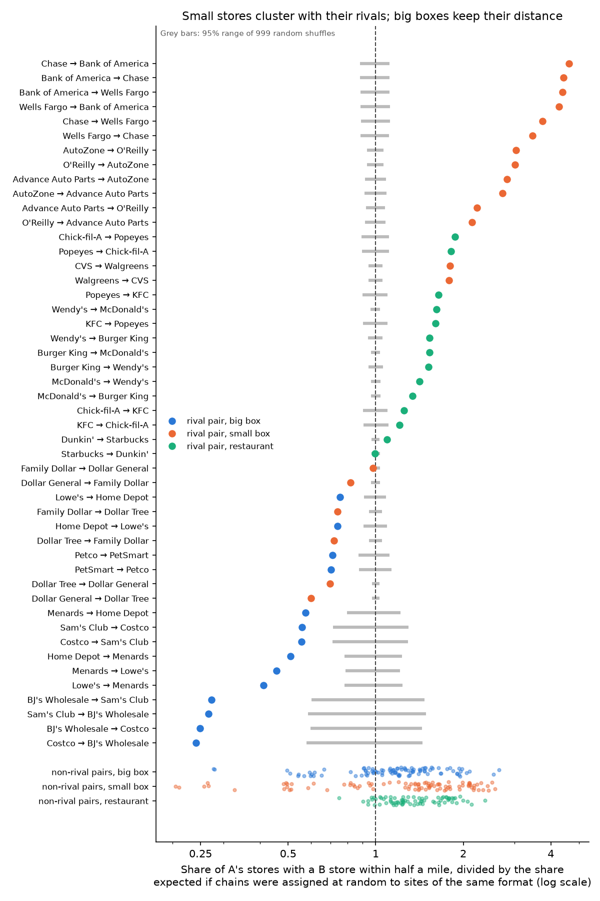
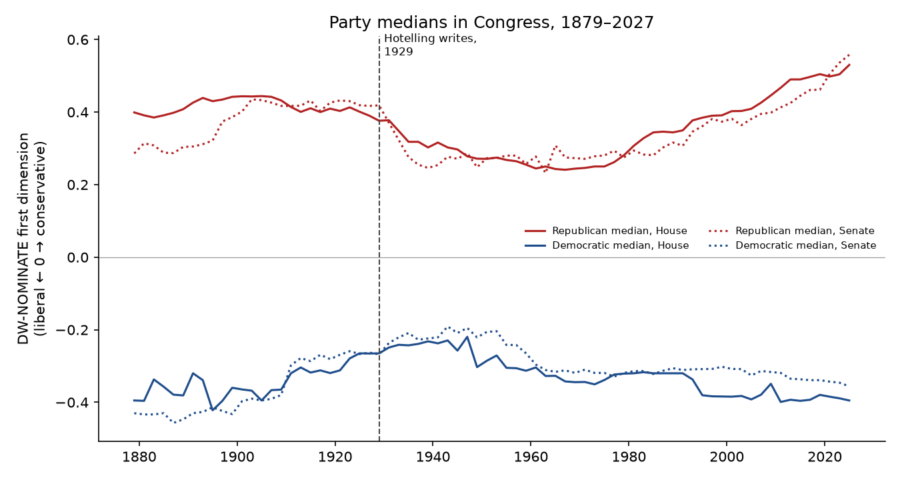

# Next Door to the Competition

### In 1929 Harold Hotelling argued that rival sellers crowd together and that distance gives each of them a little monopoly. I asked again with 174,674 American stores.

---

On commercial strips across the country, an AutoZone and an O'Reilly Auto Parts face each other across the road.
Of the 6,394 AutoZone stores in the United States, 38% have an O'Reilly within half a mile. More than half of all
Wendy's restaurants have a McDonald's that close, and so do a quarter of CVS pharmacies with a Walgreens. Chase, Bank
of America and Wells Fargo branches share corners so often that a third of Chase branches have a Bank of America
within half a mile.

The big boxes behave differently. People say Home Depot and Lowe's always open across the highway from each other,
but only 14% of Home Depots have a Lowe's within half a mile, fewer than have a Target. The typical Home Depot's
nearest Lowe's is 2.7 miles away. PetSmart and Petco, Costco and Sam's Club, and Dollar General and Dollar Tree all
stand farther from each other than chance would put them.

In 1929 Harold Hotelling, a young Stanford mathematician, wrote down a theory of why competitors cluster and what it
costs the people who shop with them. Fifty years later three economists in Louvain showed that his clustering result
does not follow from his own model, and that a close variant of the model predicts the opposite. The data supports
each side for a different kind of store.

---

## Two measures

The first measure is how often a store of one chain has a store of a rival chain right beside it. For chain A and
chain B, take every A store, find the nearest B store, and count the share that are within a radius $`r`$ (half a
mile throughout, chosen before I looked at the results):

```math
s_{AB}(r) = \frac{1}{N_A}\sum_{i=1}^{N_A} \mathbf{1}\!\left[d_i(B) \le r\right],
\qquad
R_{AB} = \frac{s_{AB}}{\mathbb{E}_0\!\left[s_{AB}\right]}
```

Here $`N_A`$ is the number of A stores, $`d_i(B)`$ is the straight-line distance in miles from A's store $`i`$ to
the nearest B store, and $`\mathbb{E}_0[s_{AB}]`$ is the share you would expect if the chains' labels were shuffled
at random among all the sites that stores of the same format occupy. A big-box store is compared with other big-box
sites, a pharmacy with other small-store sites, a burger restaurant with other restaurant sites. The ratio
$`R_{AB}`$ says how many times more often than chance A sits next to B. For AutoZone and O'Reilly:

```math
R_{\text{AutoZone}\to\text{O'Reilly}} = \frac{0.384}{0.127} = 3.03
```

| Ratio | What it means | Example from the data |
|---|---|---|
| Near 0 | The rival is almost never next door | BJ's Wholesale and Costco, 0.25 |
| 1 | Next door exactly as often as chance | Starbucks and Dunkin', 0.995 |
| Well above 1 | The rival seeks you out | Chase and Bank of America, 4.62 |

The second measure is Hotelling's own. If a shopper lives $`d_A`$ miles from store A and $`d_B`$ miles from store B
and travel costs $`c`$ dollars a mile, she buys from A whenever A's price plus the trip is cheaper:

```math
p_A + c\,d_A \le p_B + c\,d_B
\quad\Longleftrightarrow\quad
p_A - p_B \le c\,(d_B - d_A)
```

So the nearer store can charge up to $`c`$ times the distance advantage more before it loses her. That advantage is
the store's local market power. With the IRS 2026 business mileage rate of 72.5 cents and a round trip, the median
American's distance advantage between the nearest Home Depot and the nearest Lowe's, 1.50 miles, is worth:

```math
2 \times \$0.725 \times 1.503 \text{ miles} = \$2.18 \text{ per trip}
```

---

## Harold Hotelling's question

Hotelling was born in 1895 in Fulda, Minnesota. He took a degree in journalism at the University of Washington in
1919, then switched to mathematics and earned his doctorate at Princeton in 1924 with a thesis in topology. He
joined Stanford's Food Research Institute as a research associate and became an associate professor of mathematics
there in 1927. "Stability in Competition" appeared in the
*Economic Journal* in March 1929. He moved to Columbia in 1931 and to the University of North Carolina in 1946,
where he founded its department of mathematical statistics, and he died in Chapel Hill in 1973. Statisticians know
him for principal components and the $`T^2`$ test; economists know him for this paper, for the economics of
exhaustible resources, and for teaching Kenneth Arrow.

The paper starts from a puzzle about price wars. In the duopoly theories of the day, a seller who charged a cent
more than his rival lost every customer, so prices could never settle. Hotelling pointed out that real customers
drift away gradually, because some live closer to one store, or like its service, or are "a fellow Elk or Baptist."
He put the customers on a line of length $`l`$, one unit each, with seller A at distance $`a`$ from the left end,
seller B at distance $`b`$ from the right end, zero production cost, and a travel cost of $`c`$ per unit of
distance. A captures his own hinterland $`a`$ plus $`x`$ customers toward B, and B captures $`b`$ plus $`y`$. The
customer at the boundary is indifferent, which pins down $`x`$, and each seller then picks the price that maximizes
his profit given the other's price:

```math
\begin{aligned}
p_1 + c\,x &= p_2 + c\,y, \qquad a + x + y + b = l \\
\Rightarrow\; x &= \tfrac{1}{2}\left(l - a - b + \frac{p_2 - p_1}{c}\right) \\
\pi_1 = p_1(a + x) &= \tfrac{1}{2}(l + a - b)\,p_1 - \frac{p_1^2}{2c} + \frac{p_1 p_2}{2c} \\
\frac{\partial \pi_1}{\partial p_1} &= \tfrac{1}{2}(l + a - b) - \frac{p_1}{c} + \frac{p_2}{2c} = 0 \\
\Rightarrow\; p_1 &= c\left(l + \frac{a - b}{3}\right), \qquad p_2 = c\left(l - \frac{a - b}{3}\right),
\qquad \pi_{1,2} = \frac{c}{2}\left(l \pm \frac{a - b}{3}\right)^{2}
\end{aligned}
```

Prices and profits are proportional to the travel cost $`c`$, so even two honest competitors earn monopoly-style
profits as long as moving between them is costly. Hotelling's own example puts $`l = 35`$, $`a = 4`$, $`b = 1`$
and $`c = 1`$. The formulas give prices of 36 and 34, sales of 18 and 17, and profits of 648 and 578, the numbers
printed on his Figure 2, and the script in this repository reproduces them exactly. Because profit rises with
$`c`$, he observed that merchants like these "would do well" to make transportation "as difficult as possible."

The last line of the formula carries the second result. B's profit rises as $`b`$ grows, that is, as B moves toward
A, so B sets up shop right beside his rival on the side with more customers. A third seller does the same. The
public interest would put two stores at the quartiles of the line, but private sellers "crowd together as closely
as possible." Hotelling turned this into a general claim about modern life, writing that "buyers are confronted everywhere
with an excessive sameness." His examples ran from Main Street stores and sweet and sour cider to Methodist and
Presbyterian churches and the Republican and Democratic parties.

The strongest objection came in 1979, in a short note in *Econometrica* by d'Aspremont, Jean Jaskold Gabszewicz
and Jacques-François Thisse of the Center for Operations Research and Econometrics in Louvain. They noticed that
Hotelling had only checked small price changes. When the two stores are close, one of them can undercut the other's delivered price, grab the
whole line, and do better than at Hotelling's prices. An equilibrium exists only if

```math
\left(l + \frac{a-b}{3}\right)^{2} \ge \frac{4}{3}\,l\,(a + 2b)
\quad\text{and}\quad
\left(l - \frac{a-b}{3}\right)^{2} \ge \frac{4}{3}\,l\,(b + 2a)
```

which, for stores placed symmetrically, means both must sit at the quartiles, where Hotelling said a planner would
put them, or farther out toward the ends. His own example passes (1,296 against 280, and 1,156 against 420), but the clustering
he predicted does not. With travel costs that rise with the square of distance, they showed, the two sellers move
to opposite ends of the line to soften price competition, and minimum differentiation turns into maximum
differentiation.

The question has never gone away, because where competitors stand decides how much choice a shopper has on her
way home and how much a store can charge her for the convenience.

---

## How I tested it

The store locations come from All the Places, an open project that runs a scraper for each chain's own store
locator every week and releases the results without restriction. I took 32 national chains, using for each the most
recent 2026 weekly run in which its store count was complete, and kept only open stores in the 50 states and DC. I
dropped ATMs, store-within-a-store counters (the CVS pharmacies inside Targets, the licensed Starbucks counters in
airports and supermarkets) and duplicate records. That left 174,674 stores. I grouped the chains into three formats
(big box, small box, restaurant) and ten rival categories with two or three major players each, from home
improvement to fried chicken. Target, Kohl's, Best Buy, Taco Bell and Subway stay in as non-rival comparisons.

Hotelling's prediction for many stores on a map, rather than two on a line, is that a store of one chain sits next
to a store of its rival more often than next to a comparable store that doesn't compete with it. I test it two ways.
First, for each rival pair I shuffle chain labels 999 times among the sites of that format, keeping each chain's
store count fixed, and compare the observed share with the shuffled ones. Second, I fit a Poisson model to all 992
ordered pairs of chains, which asks whether rivals sit together more than non-rivals of the same format once each
chain's general taste for busy locations is removed:

```math
\mathbb{E}\!\left[n_{AB}\right] = N_A \exp\!\Big(\alpha_A + \gamma_B + \sum_{f}\delta_f\,\text{SameFormat}_{AB,f}
+ \sum_{f}\beta_f\,\text{Rival}_{AB,f}\Big),
\qquad H_0:\ \beta_f = 0
```

Here $`n_{AB}`$ is the number of A stores with a B store within half a mile, $`\alpha_A`$ and $`\gamma_B`$ are
chain fixed effects, $`\text{SameFormat}_{AB,f}`$ marks pairs where both chains are of format $`f`$, and
$`\text{Rival}_{AB,f}`$ marks rival pairs of that format. Hotelling predicts $`\beta_f > 0`$; d'Aspremont,
Gabszewicz and Thisse predict $`\beta_f < 0`$. Standard errors are clustered by unordered pair, since A-to-B and
B-to-A share the same stores, which gives 496 clusters. The shuffle test's p-value is

```math
p = \frac{1 + \#\left\{k : \left|s^{(k)} - \bar{s}\right| \ge \left|s^{\text{obs}} - \bar{s}\right|\right\}}{K + 1},
\qquad K = 999
```

where $`s^{(k)}`$ is the share in shuffle $`k`$ and $`\bar{s}`$ their mean. For the travel-cost measure I used the
2020 Census population centers of 83,848 populated tracts, covering 331 million people, and measured each tract's
distance to the nearest store of each chain.

---

## Small stores sit beside their rivals

| Rival pair | Stores of the first | Rival within half a mile | Expected by chance | Ratio |
|---|---|---|---|---|
| Chase → Bank of America | 3,569 | 32.7% | 7.1% | 4.62 |
| AutoZone → O'Reilly | 6,394 | 38.4% | 12.7% | 3.03 |
| CVS → Walgreens | 7,103 | 26.1% | 14.5% | 1.80 |
| Popeyes → Chick-fil-A | 3,124 | 19.0% | 10.5% | 1.82 |
| Wendy's → McDonald's | 5,867 | 53.8% | 33.3% | 1.62 |
| Burger King → McDonald's | 6,168 | 50.8% | 33.2% | 1.53 |
| Starbucks → Dunkin' | 9,983 | 27.2% | 27.4% | 0.99 |

Banks, auto parts stores, pharmacies and fast-food chains pair up with their rivals far more often than random
placement would produce, and every one of these ratios except the coffee pair clears the shuffle test with
p = 0.001, the smallest value 999 shuffles can give. The median small-store rival pair sits together 2.5 times as often as chance, against 1.5 times for small-store
pairs that don't compete, such as a pharmacy and an auto parts store. The Poisson model puts the rival premium for
small stores at about 51%.

Restaurants are a special case. Burger chains cluster with each other, but in the Poisson model rival restaurants
sit together no more often than restaurant pairs that don't compete, such as McDonald's and Taco Bell or Subway.
Every fast-food chain wants the same busy intersection, and the data cannot separate
competition for the same customer from simple appetite for traffic. Starbucks and Dunkin', the most famous coffee
rivalry, sit together almost exactly as often as chance.

---

## Big boxes keep their distance

| Rival pair | Stores of the first | Rival within half a mile | Expected by chance | Ratio |
|---|---|---|---|---|
| Home Depot → Lowe's | 2,013 | 13.8% | 18.6% | 0.74 |
| Lowe's → Home Depot | 1,761 | 15.7% | 20.9% | 0.75 |
| PetSmart → Petco | 1,525 | 10.5% | 15.0% | 0.70 |
| Costco → Sam's Club | 655 | 3.8% | 6.9% | 0.56 |
| BJ's Wholesale → Costco | 269 | 1.9% | 7.5% | 0.25 |
| Dollar General → Dollar Tree | 20,494 | 10.1% | 16.8% | 0.60 |
| Dollar General → Family Dollar | 20,494 | 11.0% | 13.5% | 0.82 |

The last two rows are dollar stores, which the tests count as small stores. The 14 ordered big-box rival pairs
(home improvement, warehouse clubs, pet supplies) all sit together less often than chance, and all 14 differences
clear the shuffle test at the 5% level. Non-rival big-box pairs, such as Home Depot and PetSmart, run the other way, with a median ratio
of 1.19. A Home Depot is more likely to have a Target within half a mile (24.2%) than a Lowe's (13.8%).

The two chains interleave. The median Home Depot's nearest other
Home Depot is 5.9 miles away and its nearest Lowe's is 2.7 miles away, close to halfway between. Warehouse clubs
spread out the most. A Costco's nearest Sam's Club is a median 6.4 miles away. The dollar stores behave like the big
boxes, and five of their six ordered pairs sit together significantly less often than chance. Dollar Tree owned
Family Dollar until July 2025, so part of that spacing was planned by one owner avoiding its own stores.



The Poisson model gives the same split, with half-mile counts and all 992 ordered pairs:

```math
\begin{aligned}
\hat{\beta}_{\text{big box}} &= -0.619\;(0.120), & e^{\hat{\beta}} &= 0.54\ \ [0.43,\ 0.68] \\
\hat{\beta}_{\text{small box}} &= 0.415\;(0.127), & e^{\hat{\beta}} &= 1.51\ \ [1.18,\ 1.94] \\
\hat{\beta}_{\text{restaurant}} &= 0.001\;(0.030), & e^{\hat{\beta}} &= 1.00\ \ [0.94,\ 1.06] \\
N &= 992 \text{ ordered pairs}, & &\text{496 clusters}
\end{aligned}
```

Big-box rivals sit together 46% less often than non-rival big boxes, small-store rivals 51% more often. The signs
hold at a quarter mile and at a mile. Pooled into a single rival effect the estimate is +20% (p = 0.015), but that
average hides two opposite patterns, and it falls to +7% (p = 0.32) once banks are removed.

---

## Distance still buys every store a captive market

| Rival pair | Median distance advantage of the nearer store | Worth per round trip at 72.5¢ a mile | Share of Americans 5+ miles closer to one |
|---|---|---|---|
| Costco / Sam's Club | 4.71 miles | $6.83 | 48.5% |
| Dollar General / Family Dollar | 1.99 miles | $2.89 | 31.0% |
| PetSmart / Petco | 1.78 miles | $2.59 | 23.1% |
| Home Depot / Lowe's | 1.50 miles | $2.18 | 21.6% |
| Starbucks / Dunkin' | 1.10 miles | $1.60 | 19.8% |
| CVS / Walgreens | 0.90 miles | $1.31 | 16.6% |
| McDonald's / Burger King | 0.72 miles | $1.04 | 11.1% |
| AutoZone / O'Reilly | 0.65 miles | $0.94 | 19.0% |
| Chase / Bank of America | 4.16 miles | $6.04 | 49.0% |

For the median American, the nearest Home Depot or Lowe's is 1.5 miles closer than the other. By Hotelling's
arithmetic that store could charge $2.18 more on a shopping trip before the shopper found it worth the drive to the
rival, and for a fifth of the population the gap is more than five miles, or more than $7.25 a trip. For burger
chains and auto parts stores, whose networks overlap across the country, the cushion is about a dollar. Chase and Bank of America sit together 4.6 times as often as chance where
both have branches, but their branch networks cover different regions, so the median American is 4.16 miles closer
to one than the other. These are ceilings on what geography allows, not observed price
differences, and the chains with national price lists may not use all of it.

---

## Congress stopped converging after the 1940s

Hotelling's boldest example was political. He wrote that each party "strives to make its platform as much like
the other's as possible," and that real differences fade with time. I measured the distance between the parties
with DW-NOMINATE, the Voteview scores that place every member of Congress on a liberal-to-conservative scale from
roll-call votes, and took the gap between the Republican and Democratic medians in each Congress, $`G_t`$. The test
of convergence is the trend $`\theta`$ in

```math
G_t = \alpha + \theta\,t + u_t, \qquad H_0:\ \theta = 0
```

estimated with Newey-West standard errors over eight years of lags. In the House that Hotelling watched, the 70th
Congress of 1927 to 1929, the median gap was 0.656. It narrowed to 0.498 by 1947, and in the half century after
the paper the trend was flat. After 1979 the gap widened steadily:

```math
\begin{aligned}
\text{House, 1929–1979:}\quad \hat{\theta} &= 0.002\;(0.007) \text{ per decade}, & 95\%\ \text{CI}\ &[-0.012,\ 0.015] \\
\text{House, 1979–2027:}\quad \hat{\theta} &= 0.069\;(0.003) \text{ per decade}, & 95\%\ \text{CI}\ &[0.062,\ 0.076] \\
\text{Senate, 1979–2027:}\quad \hat{\theta} &= 0.063\;(0.007) \text{ per decade}, & 95\%\ \text{CI}\ &[0.050,\ 0.076]
\end{aligned}
```

| House | Party gap | Members on the other party's side of the line | Most conservative Democrat | Most liberal Republican |
|---|---|---|---|---|
| 1927–29 | 0.656 | 45 | John Morehead | Richard Welch |
| 1947–49 | 0.498 | 106 | John Bell Williams | Richard Welch |
| 1977–79 | 0.586 | 196 | Larry McDonald | Charles Whalen |
| 2025–27 | 0.925 | 0 | Marie Gluesenkamp Perez | Brian Fitzpatrick |

The last House with any overlap at all was the 107th, of 2001 to 2003. Today the most conservative Democrat, Marie Gluesenkamp
Perez, scores to the left of the most liberal Republican, Brian Fitzpatrick, and in the Senate John Fetterman
scores to the left of Susan Collins. Most of the widening came from Republicans moving right.



The gap narrowed for about twenty years after Hotelling wrote and then stopped narrowing. He had attached a caveat
to his store model that bears on the later divergence. With elastic demand, he wrote, the second seller will
"choose a location at some distance" from the first, though not as far as the public interest would require. Voters
who stay home when their party drifts toward the middle make the demand for a platform elastic in the same way.

---

## Why it matters

For shoppers, the clustering of small stores is mostly good news. Three auto parts stores at one intersection let a
driver compare prices on foot, and the distance advantage of the nearer store shrinks to under a dollar a trip. The
big boxes are another matter. Home Depot and Lowe's, Costco and Sam's Club, and PetSmart and Petco each leave large
territories in which one of them is the obvious trip, and Hotelling's arithmetic says that territory is worth several
dollars a visit to whichever store holds it.

For smaller firms, the pattern decides where there is room to enter. An independent pharmacy or parts store that
opens next to the chains joins an existing cluster of shoppers. A hardware store or pet shop competes in the gaps the
big boxes leave, which is where the chains' own spacing says their customers are least contested.

For antitrust, the result is a warning about counting competitors. Reviews of retail mergers usually start by
counting the local markets where both chains have stores. Big-box rivals that
avoid each other may show little overlap even when, for the household between them, they are the only two choices
worth the drive.

For voters, Hotelling's middle ground has disappeared from the House floor. No House Democrat now votes to the right
of any Republican, and no Republican to the left of any Democrat. In every House from 1929 to 2001 at least four
members did.

---

## Limits of this study

Distances are straight lines, not roads, and a half mile across a divided highway is farther than it looks. The
store lists come from each chain's locator as scraped in one week of 2026 (July for Lowe's), so recent closures and
openings may be missing, and a few chains' scrapers could miss some stores. The shuffle test keeps the existing
sites fixed, so it asks which chain sits on which site, not why the shopping centers are where they are, and my
grouping into three formats is a judgment. Clustering can come from zoning, traffic counts or developers who sign
competing tenants, not only from competition for the same customers, and avoidance can come from exclusivity
clauses in leases. I have no prices, so the travel-cost figures are Hotelling's ceilings rather than measured
markups. DW-NOMINATE measures roll-call votes, not party platforms, and its comparisons across decades rest on the
assumption that members' positions move slowly.

---

## Further reading

- [TECHNICAL.md](TECHNICAL.md): data, method, every test statistic and how to reproduce the results.
- [results/FINDINGS.md](results/FINDINGS.md): plain-English summary and every table the scripts produce.
- [METHODS_REVIEW.md](METHODS_REVIEW.md): a methods review of the original paper.
- Harold Hotelling, "Stability in Competition," *Economic Journal* 39(153), March 1929, pp. 41–57.
- C. d'Aspremont, Jean Jaskold Gabszewicz and Jacques-François Thisse, "On Hotelling's 'Stability in
  Competition'," *Econometrica* 47(5), September 1979, pp. 1145–1150.
- Store locations: All the Places, weekly runs of July to October 2026, released under CC0
  (https://www.alltheplaces.xyz/).
- Population: US Census Bureau, 2020 Census centers of population by tract
  (https://www2.census.gov/geo/docs/reference/cenpop2020/tract/).
- Roll-call scores: Lewis, Poole, Rosenthal, Boche, Rudkin and Sonnet, *Voteview: Congressional Roll-Call Votes
  Database* (https://voteview.com/).
- Mileage rate: Internal Revenue Service, IR-2025-128, December 29, 2025.

*Brendyn Beasley*
